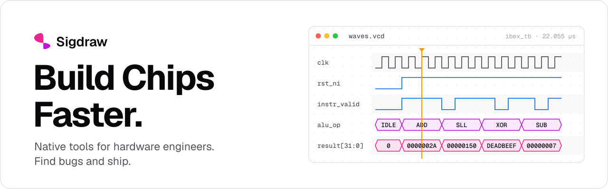
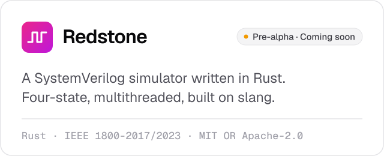
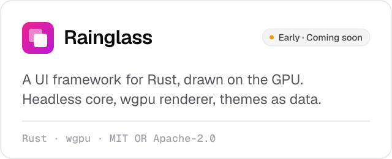

<a href="https://www.sigdraw.com">
  <picture>
    <source media="(prefers-color-scheme: dark)" srcset="assets/banner-dark.svg">
    
  </picture>
</a>

  <a href="https://www.sigdraw.com"><b>Website</b></a> &nbsp;·&nbsp;
  <a href="https://www.sigdraw.com/download"><b>Download</b></a> &nbsp;·&nbsp;
  <a href="https://www.sigdraw.com/docs"><b>Docs</b></a> &nbsp;·&nbsp;
  <a href="https://www.sigdraw.com/releases"><b>Release notes</b></a> &nbsp;·&nbsp;
  <a href="https://www.sigdraw.com/feedback"><b>Feedback</b></a>

 

**Sigdraw** builds tools for the people who design chips. Our first product is a free, native IDE for SystemVerilog, Verilog and VHDL. It reads your design, runs it, shows you the waves and lets you edit the code, all in one window that keeps those four things in step.

We built the IDE we wanted as hardware engineers. Hardware deserves better tools.

## Sigdraw

<table>
  <tr>
    <td width="50%" valign="top"><b>Diagrams</b> Your RTL, drawn live as block diagrams that stay in sync with the source. Edit either one and the other follows.</td>
    <td width="50%" valign="top"><b>Simulation</b> Bring your own simulator. Sigdraw finds your testbenches, runs them and keeps every run.</td>
  </tr>
  <tr>
    <td width="50%" valign="top"><b>Waveforms</b> VCD, FST and GHW files, indexed once and drawn on the GPU at your display's refresh rate.</td>
    <td width="50%" valign="top"><b>Editor</b> A real code editor built for HDL, with terminals and git in the same window.</td>
  </tr>
</table>

<b>Supported languages, simulators and formats</b>

 

<table>
  <tr><td><b>Languages</b></td><td>SystemVerilog · Verilog · VHDL</td></tr>
  <tr><td><b>Simulators</b></td><td>Verilator · Icarus Verilog · GHDL · NVC · Vivado xsim · Questa* · Xcelium* · VCS*</td></tr>
  <tr><td><b>Waveforms</b></td><td>VCD · FST · GHW</td></tr>
  <tr><td><b>Platforms</b></td><td>macOS (Apple Silicon) · <a href="https://www.sigdraw.com/download">other platforms</a></td></tr>
</table>

\* Not yet tested by us. Sigdraw calls these the way each one's published documentation describes.

**Private.** No account and no telemetry. Sigdraw works offline and never sends your RTL to us.

**[Download Sigdraw for macOS →](https://www.sigdraw.com/download)** &nbsp;Free · No account · Public beta

## Open source

We're releasing two of the projects behind Sigdraw as open source under **MIT OR Apache-2.0**. Both are written in Rust and both are early. Once the repositories open, we'll develop them in public rather than wait until they're finished.

  <picture>
    <source media="(prefers-color-scheme: dark)" srcset="assets/redstone-dark.svg">
    
  </picture>
  &nbsp;
  <picture>
    <source media="(prefers-color-scheme: dark)" srcset="assets/rainglass-dark.svg">
    
  </picture>

**Redstone** is a SystemVerilog simulator for IEEE 1800-2017 and 1800-2023. It uses [slang](https://github.com/MikePopoloski/slang) as its frontend, has full four-state semantics from day one, and runs multithreaded on the CPU. Correctness comes before speed: every fast path must match a reference interpreter bit for bit.

**Rainglass** is the UI framework Sigdraw is drawn with. Its core is headless: it emits display lists and damage regions, and it has no dependency on a windowing system or a GPU API, so you can test it without a window. A separate wgpu renderer draws those display lists, and themes are plain TOML data.

Both repositories open soon. If you want to contribute, start with the [contributing guide](https://github.com/Sigdraw/.github/blob/main/CONTRIBUTING.md). To report a vulnerability, see the [security policy](https://github.com/Sigdraw/.github/blob/main/SECURITY.md).

## Inlay

**Agents are coming to Sigdraw.** Inlay is the agent we're building into Sigdraw. It works from your diagrams, waveforms and simulator runs, and brings every change back to you as a diff to approve. Inlay will be a subscription; Sigdraw itself stays free.

[Join the waitlist →](https://www.sigdraw.com/inlay#waitlist)

## Say hello

We're based in Brooklyn, NY. To reach us, email [hello@sigdraw.com](mailto:hello@sigdraw.com) or use the [contact page](https://www.sigdraw.com/contact).

 

  © 2026 Sigdraw · <a href="https://www.sigdraw.com/terms">Terms</a> · <a href="https://www.sigdraw.com/privacy">Privacy</a>

